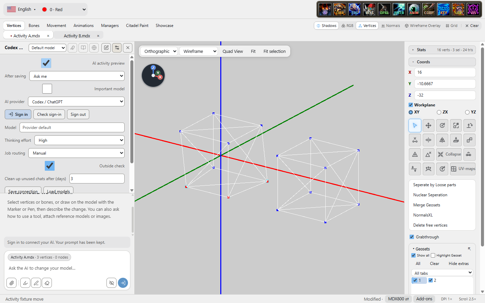

# AI activity preview trial

Status: ready for review; awaiting merge approval. No merge, version bump or release.
Owner: Codex — Astra contract: MDLxL AI activity trial
Updated: 2026-10-29

## Scope and behavior

One session-only **AI activity preview** checkbox in AI settings, off at startup.
The main single 3D viewport in Vertices mode shows an amber target pulse while a
real editing script or patch executes, then cyan rings on positions that actually
changed after the existing save validation succeeds. The completion lasts 1.1 s,
including a 250 ms fade, and means **change applied**, even while AI review is pending.
Fast synchronous patches may finish before a pulse can paint; execution is never
held for an effect.

A broad scope, changed topology/correspondence, or a large position change uses a
coarse projected geoset region. No imagined sequence of vertex work. No target
scope means no target pulse. Drawing is capped at 512 vertex rings / 32 geoset
regions per operation, with at most 16 retained operations. Target effects expire
after 30 s at most. One expiry timer and the existing viewport scheduler stop when
idle. Turning the checkbox off clears the canvas immediately.

The model, real selection, revision and Undo history remain owned by the existing
editor. Activity is keyed by document identity, operation and revision; cancellation,
failure, rollback, closure, stale results and subsequent revisions discard it.
Other editors, Quad View and NormalsXL previews are outside this trial.

No provider, prompt, tool schema, tool-result field, screenshot request or
live-awareness message was added. AI viewport captures omit the local overlay;
full-editor captures hide it through the compositor's next paint. This wait is
only for capture correctness, never for extending an edit animation.

## Source

Branch: codex/ai-activity-trial
Base: 0635d566, updated from task-start main 8a36f2a1 to preserve PR #371.
The activity UI checks were repeated after this update. Inspected reference
13d2c437d359fd583bf8071195ec88c4908052e4 without reverting newer changes.

- app/ai-editor.js: begin at real dispatch; reuse commit validator deltas and the
  existing before snapshot; publish completion only after save validation.
- app/ai-activity.js: renderer-local lifetime and actual-position comparison.
- app/Viewport.jsx, app/ai-activity-overlay.js: existing posed geometry, Three
  projection and render scheduler; a separate canvas with no pointer handling.
- app/AiAssistant.jsx: existing settings styling, no persistence.
- app/game-preview-capture.js: viewport/full-editor capture exclusion.
- src/editor-document.js and src/history-store.js were inspected and preserved.

## Run the trial on this PC

Use PowerShell. These commands create a new trial checkout and profile on D:.
The existing D:\Claude\MDLxL\node_modules supplies the installed dependencies;
the current installed MDLxL and its profile are not changed.

~~~powershell
git -C D:\Claude\MDLxL fetch origin codex/ai-activity-trial
git -C D:\Claude\MDLxL worktree add --detach D:\Codex\mdlxl-ai-activity-try origin/codex/ai-activity-trial
New-Item -ItemType Junction -Path D:\Codex\mdlxl-ai-activity-try\node_modules -Target D:\Claude\MDLxL\node_modules
Set-Location D:\Codex\mdlxl-ai-activity-try
New-Item -ItemType Directory -Force out\trial-profile,out\tmp
$env:MDLXL_PROFILE = "$PWD\out\trial-profile"
$env:MDLXL_DISABLE_UPDATES = '1'
$env:TEMP = "$PWD\out\tmp"
$env:TMP = $env:TEMP
pnpm run build
pnpm start
~~~

Open a disposable model, stay in **Vertices**, select a few vertices, open **AI →
Connection settings**, and enable **AI activity preview**. Use your normal AI
connection to ask for a small position change to those selected vertices. Normal
AI task usage remains normal; the preview adds none. Amber is the possible target,
cyan is the applied change. Toggle off to clear it; restart returns it to off.

## Verification performed

- Build and disposable package succeeded. The package retained the normal runtime
  and 55 Electron locales. Final production bundle was rebuilt before UI checks.
- 57/57 compatibility tests passed.
- 52/52 focused tests passed (ai-activity, ai-model, viewport-correctness,
  game-preview-capture, ai-offload).
- 31/31 packaged interaction checks passed after updating to current main.
  Packaged interaction harness: actual checkbox clicks, file opening, tabs,
  target closure and mouse rotation on the hidden Windows desktop. Actual MCP
  tool calls run the normal bridge and disposable script sandbox; no paid model
  or mock activity renderer was used.
- Three known selected vertices pulsed; only the two numerically moved vertices
  received the completion rings. Projection matched the actual posed geometry.
  A patch also produced its actual single-vertex completion.
- Read-only, no-op, rejected, cancelled and save-rollback operations produced no
  successful highlight. Save failure was injected at the real serializer gate.
- Tab switching, closure and a user edit during a running script did not attach
  effects to the wrong model or a stale revision.
- On/off edits produced identical geometry and selection, one normal Undo step,
  and identical tool-result content apart from normal target/revision identity.
  Undo/Redo restored the expected positions.
- Toggle changes produced no AI traffic. Existing AI viewport and full-editor
  captures were byte-identical with an active effect enabled/disabled for an
  unchanged model/view. No unsolicited requests or awareness events occurred.
- Disabling removed the canvas immediately. After expiry and its final clearing
  frame, the static viewport made no render calls during the measured idle interval.
- A 16,384-vertex edit used one coarse region and zero vertex markers. Actual
  Alt+mouse rotation changed the camera during execution. No renderer errors.

The harness includes an asynchronous fixture script to make the start phase
observable; the product adds no delay. Screenshots below are from the packaged
editor, not a standalone mockup.

Full source suite: 2,102 passed, 22 skipped, 9 failed out of 2,133. Eight native
provider process-fixture failures reproduced on untouched base 8a36f2a1 on this
Windows host. The ninth was a region-scheduler timing assertion under the full
parallel run; it passed on focused rerun and on the base. No unrelated fixes or
baseline changes were made. PR CI is the separate Linux gate.

Not exercised: a paid provider conversation, artistic acceptance on the user's
models, or Warcraft III gameplay. This is a local visualization trial, not a
change to model editing semantics or an assertion that AI review passed.

## Running-editor evidence

Target pulse: the three selected corners of the first cube are the possible area.

Change applied: only the two corners that moved are highlighted; the selected
middle corner remains unchanged.

## Repeat acceptance

After building and packaging to out/pkg, run the focused harness on the hidden
desktop, with Playwright available through MDLXL_PLAYWRIGHT_MODULE or the
existing D:/Claude/tools/node_modules/playwright-core:

~~~powershell
$env:TEMP = "$PWD\out\tmp"
$env:TMP = $env:TEMP
$env:MDLXL_HIDDEN_COMMAND = 'cmd /c "node test\ai-activity.electron.cjs > out\ai-activity.log 2>&1"'
powershell -NoProfile -ExecutionPolicy Bypass -File scripts\hidden-run.ps1 -WorkDir $PWD
~~~

out/ai-activity/checks.json records each assertion. The harness always exits
the disposable app. Remove its disposable profile/build after verification.
Stop at this trial; further development depends on the owner's decision.
