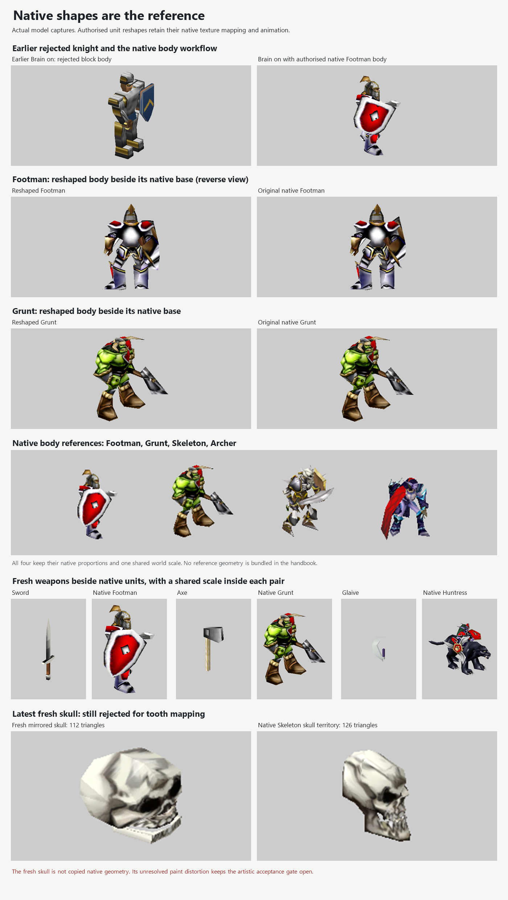
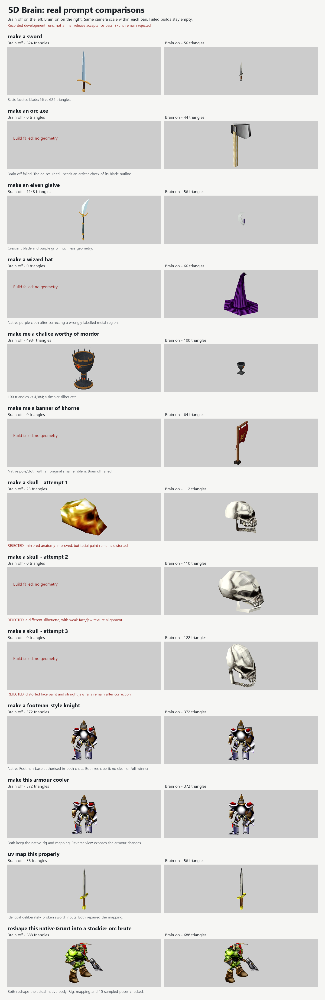

# SD Brain: Warcraft III knowledge and native unit shapes

The native unit workflow is ready for owner testing. It uses actual Warcraft III bodies and reshapes their existing surfaces, keeping their texture mapping, skeleton and animation. SD Brain remains disabled in shippable source. This is draft work: fresh skulls still fail the artistic checks, so the full feature is not ready to enable.

The earlier block-body knight was rejected. The new workflow inspects the native Footman, Grunt, Skeleton or Archer in the Library, compares their posed proportions, then uses the requested native base when the user authorises reshaping. The handbook includes measured examples: the Footman's head and helmet occupy about a quarter of its visible height; the Grunt and Archer use different proportions. It does not assume realistic human proportions for every unit.

The casual knight comparison includes the same standing instruction in both chats: later unit requests may use and reshape native bodies. The actual tested prompt remains **make a footman-style knight**. Both results are native Footman reshapes. This demonstrates the authorised native workflow; it does not establish fresh body generation or a clear Brain on/off winner.

Independent checks found real shape changes in both the Footman and Grunt. The Brain-on Footman changes 205 vertices; the Grunt changes 161. Their face connections, texture coordinates, bindings, bones, animation tracks, attachments and events were preserved, with no new gaps between previously coincident seam positions. Fifteen Stand/Walk/Attack samples were checked for each. The Footman copy into an empty Classic document keeps the effective Classic material stack; unused modern material defaults are adapted by the existing format conversion.

The handbook now has 23 subject chapters. Its installed-game data covers 3,448 distinct native models and 72,170 measured regions/components, including 6,041 classified named-bone territories. Most components remain unclassified. A bone territory can include adjoining surfaces, hair or equipment, so its count is not a rigid anatomical limit. The native texture catalogue contains 8,985 entries, with 15 sheets and 54 regions checked by eye. Unchecked regions remain unknown.

The AI fetches the relevant chapters, searches native textures by purpose and maps selected faces onto checked regions through the existing editing workflow. Unit, Archer and Skeleton requests retrieve the body reference chapter. The review measures excess density, roundness and smoothing, and returns possible contact problems for visual inspection. A read-only UV chart check helps identify collapsed or folded facial layouts. These checks guide the modeller; they do not prove that a result looks right.

The following are recorded development runs. Each on/off pair used the same package, provider and exact prompt. The pairs span several policy revisions, listed below; this is not a complete acceptance rerun of the final revision. Counts include hidden surfaces in native unit files. Zero means a failed build left no geometry.

| Prompt | Brain off triangles | Brain on triangles | Result of this pair | Policy revision suffix |
| --- | ---: | ---: | --- | --- |
| make a sword | 624 | 56 | Basic faceted sword; much less geometry | .6 |
| make an orc axe | 0 | 44 | Off failed; on blade outline still needs artistic review | .6 |
| make an elven glaive | 1,148 | 56 | Simpler crescent and purple grip | .6 |
| make a wizard hat | 0 | 66 | Off failed; native purple cloth on the on result | .7 |
| make me a chalice worthy of mordor | 4,984 | 100 | Simpler faceted cup | .6 |
| make me a banner of khorne | 0 | 64 | Off failed; on uses native material with an original emblem | .6 |
| make a skull, first run | 23 | 112 | Rejected: distorted facial paint | .12 |
| make a skull, second run | 0 | 110 | Rejected: weak face/jaw mapping | .12 |
| make a skull, third run | 0 | 122 | Rejected: distorted paint and straight jaw rails | .12 |
| make a footman-style knight | 372 | 372 | Both reshape the authorised native Footman | .13 |
| make this armour cooler | 372 | 372 | Both make local armour changes and preserve the rig/mapping | .13 |
| uv map this properly | 56 | 56 | Both repair identical deliberately collapsed sword UVs | .12 |
| reshape this native Grunt into a stockier orc brute | 688 | 688 | Both reshape the native body and preserve its setup | .15 |

The three fresh skulls have different shapes even after removing translation and whole-model scale. They remain rejected. A later .14 pair produced 50,799 triangles with Brain off and 112 with Brain on. The on result used mirrored geometry and shared side UVs, but its upper teeth still smear across the mouth and a correction changed the intended height. The organiser reported it unfinished. The native reference picture above includes that failure. Fewer triangles alone do not meet the visual goal.

The armour pair starts from identical Footman copies. The UV pair starts from identical copies of our generated sword with all UVs collapsed to one point. Independent checks confirmed that the UV repair changed the mapping while preserving the actual triangle positions, rig, materials and textures. Both controls repaired it, so this case demonstrates preservation rather than a Brain advantage.

Verification: compatibility tests passed 57/57; the full source suite passed 1,935 tests with 22 skipped and no failures. The final focused knowledge/target/MCP checks passed 36/36. Hidden packaged knowledge checks passed 20/20, including actual mouse rotation in the editor and Library, native reference inspection, compatible copying, file round trips and Undo. Parked packaged checks passed 52 console, 17 awareness and 63 editor checks. The editor run omitted the existing broken fake native sign-in fixture and moved its blank-canvas focus click away from main's new compass, only in an ignored local runner; tracked checks were not weakened. Real prompt trials used the real provider. A final five-check packaged smoke test confirmed that parked SD Brain cannot be enabled and its switch, guides and tool fields stay hidden.

All app tests ran on a hidden desktop with disposable profiles. The owner's open application was left alone. Warcraft III gameplay acceptance has not been exercised. Remaining acceptance work is the fresh skull face/jaw mapping, the axe outline and a final visual rerun of the complete prompt matrix. The owner decides when this parked feature may ship.